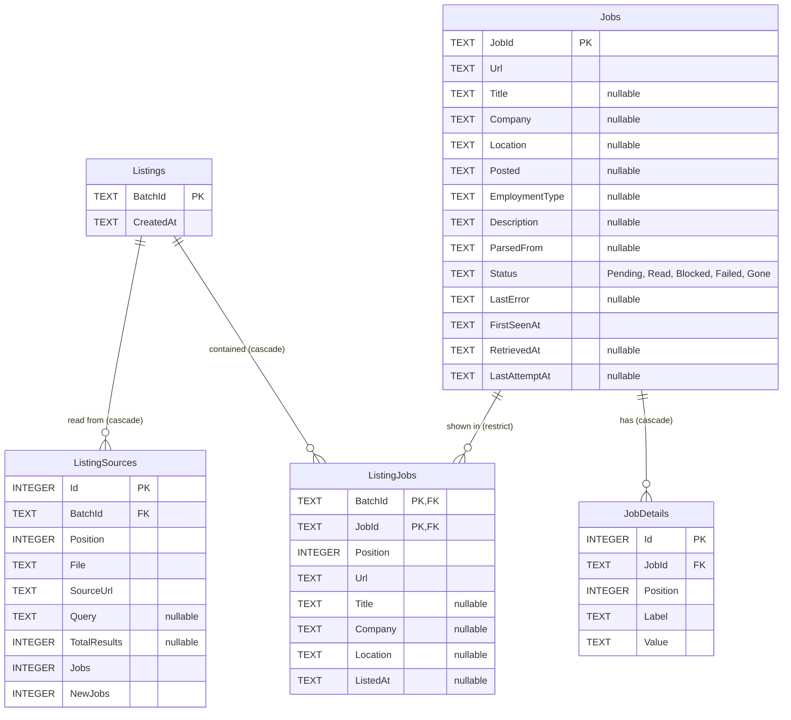

# Database design

`jobs.db` (SQLite), created and migrated by the console app through EF Core. The tables are defined in `src/JobFetchProbe.Data` (`Entities/` and `Configurations/`, one class each per table). This page describes the model after the migration `RemoveSearchesAndListingProgress`.

## Two groups of tables

- **Listings** (green), written by step 1. A *listing* is one run of step 1 that stored something: the saved pages it read (`ListingSources`) and the job cards those pages showed (`ListingJobs`), exactly as shown.
- **Jobs** (blue), read and filled by step 2. `Jobs` has one row per job, however many listings show it; `JobDetails` holds the labelled facts from the job page. The web app and the API read only these two tables.

`ListingJobs` connects the two groups: one row per job per listing, so the same job can appear in many listings while being stored, and read, only once.

## Relationships

| Parent | Child | Key | On delete of the parent |
| --- | --- | --- | --- |
| `Listings` | `ListingSources` | `BatchId` | cascade: its pages are deleted too |
| `Listings` | `ListingJobs` | `BatchId` | cascade: its cards are deleted too |
| `Jobs` | `ListingJobs` | `JobId` | restrict: a job cannot be deleted while a listing shows it |
| `Jobs` | `JobDetails` | `JobId` | cascade: its details are deleted too |

## Notes

- **Dates** (`CreatedAt`, `FirstSeenAt`, `RetrievedAt`, `LastAttemptAt`) are `DateTimeOffset` values stored as ISO-8601 text. `Posted` and `ListedAt` are the text the page showed (for example "Hace 23 horas"), not dates.
- **`Jobs.Status`** is stored as text: `Pending` (never tried), `Read`, `Blocked`, `Failed` (tried again on the next run) or `Gone` (404/410, not tried again).
- **`Position`** keeps the order of pages, cards and details as they appeared.
- **Indexes** speed up the queries the app runs: jobs by status (step 2's work list), by company, and children by parent.
- EF Core also keeps its own table, `__EFMigrationsHistory`, with the migrations already applied. It is not part of the design and is not shown.

## Mermaid version

The same model as text, rendered by GitHub and by editors with Mermaid support. Edit this when the tables change; `database.svg` is generated from the same information.

