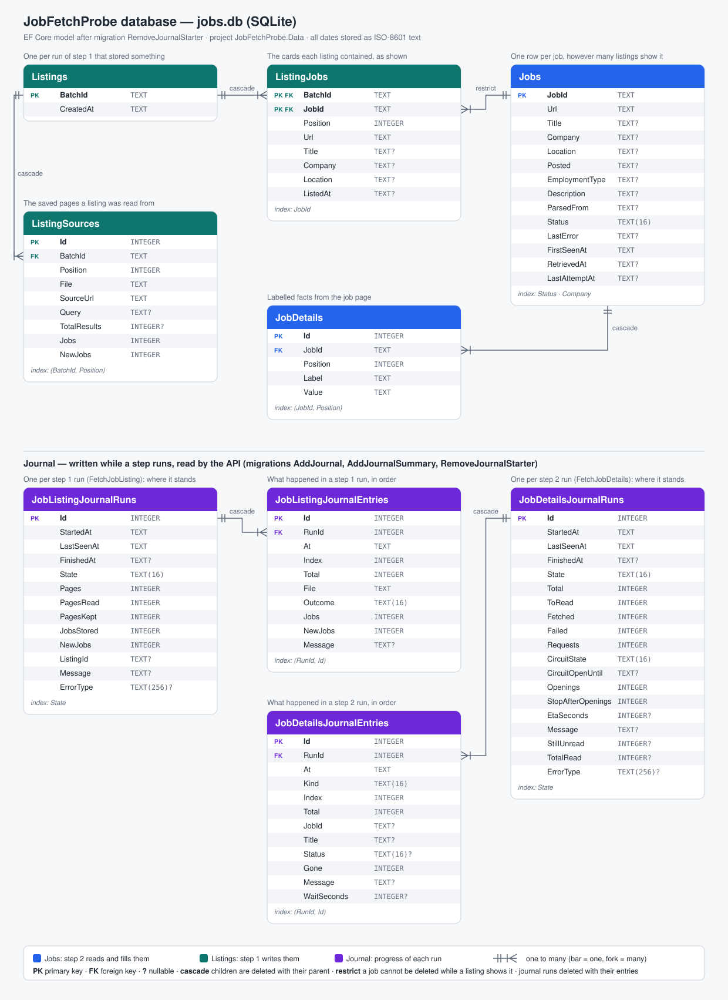
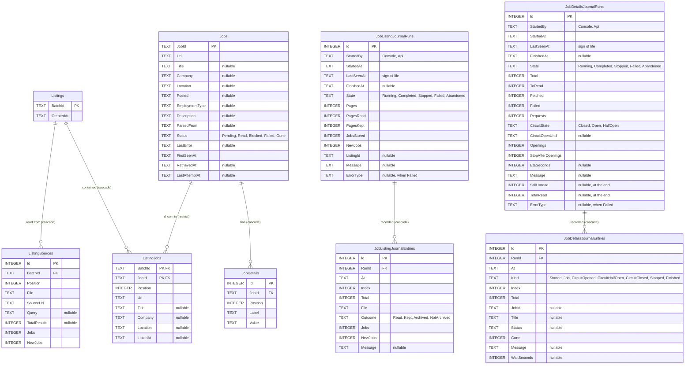

# Database design

`jobs.db` (SQLite), created and migrated by the console app or the API (at start-up) through EF Core. The tables are defined in `src/JobFetchProbe.Data` (`Entities/` and `Configurations/` for jobs and listings, `Journal/Entities/` and `Journal/Configurations/` for the journal; one class each per table). This page describes the model after the migration `AddJournalSummary`.

## Three groups of tables

- **Listings** (green), written by step 1. A *listing* is one run of step 1 that stored something: the saved pages it read (`ListingSources`) and the job cards those pages showed (`ListingJobs`), exactly as shown.
- **Jobs** (blue), read and filled by step 2. `Jobs` has one row per job, however many listings show it; `JobDetails` holds the labelled facts from the job page. The web app and the API read only these two tables.

`ListingJobs` connects the two groups: one row per job per listing, so the same job can appear in many listings while being stored, and read, only once.

- **Journal** (violet), written while a step runs and read by the API, from another process, at the same time. One pair of tables per step, because the two steps report different things:
  - `JobListingJournalRuns` / `JobListingJournalEntries`: step 1 (FetchJobListing) runs, and per page what happened (read, kept, archived).
  - `JobDetailsJournalRuns` / `JobDetailsJournalEntries`: step 2 (FetchJobDetails) runs, and per job and per circuit breaker change what happened.

  Migration `AddJournalSummary` (18 Oct 2026) adds what the web page's summary and error pane need: `StillUnread` and `TotalRead` on step 2 runs (set when the run ends), and `ErrorType` on both (the type of the error when a run fails, for example `Microsoft.Data.Sqlite.SqliteException`; its text is in `Message`).
  The *run* row is where the run stands now (state, counters, circuit breaker, last sign of life); the *entries* are what happened, in order. A reader asks for a run with the entries after the last id it has, and stops when the state is no longer `Running`. The journal is not linked to the other tables by keys (`ListingId` is informational), so it can be pruned freely.

## Relationships

| Parent | Child | Key | On delete of the parent |
| --- | --- | --- | --- |
| `Listings` | `ListingSources` | `BatchId` | cascade: its pages are deleted too |
| `Listings` | `ListingJobs` | `BatchId` | cascade: its cards are deleted too |
| `Jobs` | `ListingJobs` | `JobId` | restrict: a job cannot be deleted while a listing shows it |
| `Jobs` | `JobDetails` | `JobId` | cascade: its details are deleted too |
| `JobListingJournalRuns` | `JobListingJournalEntries` | `RunId` | cascade: its entries are deleted too |
| `JobDetailsJournalRuns` | `JobDetailsJournalEntries` | `RunId` | cascade: its entries are deleted too |

## Notes

- **Dates** (`CreatedAt`, `FirstSeenAt`, `RetrievedAt`, `LastAttemptAt`) are `DateTimeOffset` values stored as ISO-8601 text. `Posted` and `ListedAt` are the text the page showed (for example "Hace 23 horas"), not dates.
- **`Jobs.Status`** is stored as text: `Pending` (never tried), `Read`, `Blocked`, `Failed` (tried again on the next run) or `Gone` (404/410, not tried again).
- **`Position`** keeps the order of pages, cards and details as they appeared.
- **Indexes** speed up the queries the app runs: jobs by status (step 2's work list), by company, and children by parent.
- **Journal states** (`State`): `Running`, `Completed`, `Stopped` (circuit breaker gave up, or Ctrl+C), `Failed` (an error, in `Message`), `Abandoned` (no sign of life for 2 minutes: the process ended without saying so). A running process refreshes `LastSeenAt` at least every 30 seconds. `CircuitOpenUntil` is written once when the circuit opens; readers compute the countdown from it.
- **Journal size:** each step keeps its last 50 runs; older runs and their entries are deleted when a new run starts. To be reviewed (a TODO in `JournalService` and an item in `backlog.md`): a process that fails over and over keeps adding runs.
- EF Core also keeps its own table, `__EFMigrationsHistory`, with the migrations already applied. It is not part of the design and is not shown.

## Mermaid version

The same model as text, rendered by GitHub and by editors with Mermaid support. Edit this when the tables change; `database.svg` is generated from the same information.

