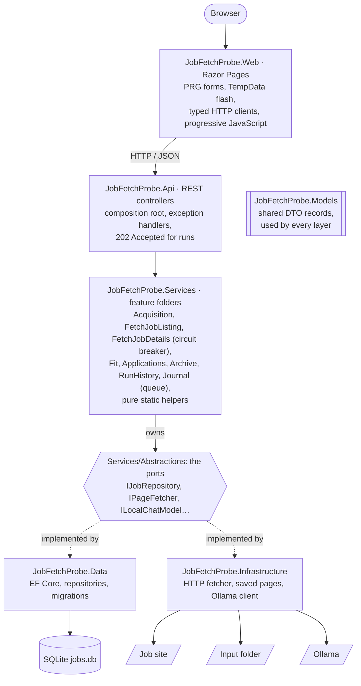
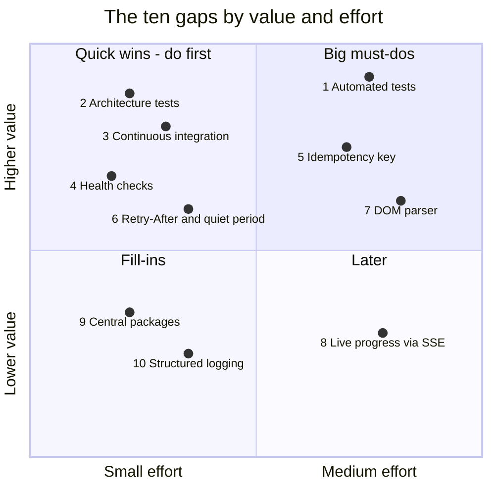

# Job Fetch Probe: patterns review

25 Oct 2026 · Daniel. A copy of the doc "Job Fetch Probe: patterns review"; the two drawings are Mermaid diagrams here.

## Summary

Job Fetch Probe follows a clean layered architecture with ports and adapters, and applies 38 recognised patterns, most of them well. The biggest gap is not a pattern but a safety net: there are no automated tests, no CI, and nothing that enforces the layering rules in `CLAUDE.md`.

The application is a single-user .NET 10 system in two processes: a Razor Pages web app and a REST API, with the services behind the API (about 13,500 lines of C# across six projects, 40 interfaces, 78 records). It reads saved LinkedIn search pages, fetches job descriptions politely behind a circuit breaker, scores each job with a local model (Ollama), and tracks applications.

What stands out:

- **Strong:** strict layering with dependency inversion, a hand-built circuit breaker with throttling, a journal that can never slow or stop a run, ProblemDetails errors, and a database that keeps history (append-only notes and fit scores).
- **Missing:** a test project, CI, architecture tests, health checks, and a few reliability items already analysed in `backlog.md` (idempotent start, live progress).
- **Top three to add:** (1) a test project for the pure helpers and the parsers, with saved pages as fixtures; (2) architecture tests that fail the build when a layer rule is broken; (3) a CI build that runs both on every push.

Scope: the code on your computer as of 25 Oct 2026 (commit e5bcfed plus the uncommitted application search). Patterns are named as in common references (Fowler's *Patterns of Enterprise Application Architecture*, the Microsoft cloud design patterns, the .NET guidance).

## Architecture patterns in use

The structure is a layered architecture with dependency inversion at its lower edge, which is ports and adapters (hexagonal) in all but name. Each rule is applied consistently across the six projects.

Services owns the interfaces; Data and Infrastructure implement them, so the business rules never depend on SQLite, HTTP or Ollama.

| Pattern | Where it shows | Verdict |
| --- | --- | --- |
| Layered architecture (strict) | Web → Api → Services → Data or Infrastructure; each project references only the one below | Well applied; documented in `CLAUDE.md` but enforced only by review |
| Dependency inversion / ports and adapters | Interfaces in `Services/Abstractions` (`IJobRepository`, `IPageFetcher`, `ILocalChatModel`…), implemented by Data and Infrastructure | Well applied: Services never knows SQLite, HTTP or Ollama |
| Composition root | Only `Api/Program.cs` and `Web/Program.cs` wire implementations, through `AddJobStore()`, `AddRunHistory()`… extension methods | Well applied; one module per feature |
| Feature folders (vertical slices inside each layer) | `Applications`, `Archive`, `Fit`, `RunHistory`, `FetchJobDetails`… repeated in every project | Well applied; new features stay isolated |
| Shared contracts (DTO assembly) | `JobFetchProbe.Models`: records only, no logic, no entities | Well applied; entities (`…Row`) never leave Data |
| Separated presentation (web as an API client) | Web never touches the database or Ollama; typed clients call the API | Well applied; keeps the API the single gateway |
| Service layer / transaction script | Business rules live in services (`ApplicationTracker`, `JobDetailsFetcher`), models are plain records | A deliberate, fitting choice for this size; no rich domain model needed |
| Functional core, imperative shell | `internal static` helpers of pure functions (`TextFilter`, `RunPairing`, `Step2Outcome`, `ListingPages`) called by the stateful services | Well applied; these are the easiest code to test, and none are tested yet |
| Options pattern with validation at start-up | `FetchJobDetailsSettings`, `CircuitBreakerSettings`, `JobCatalogApiSettings` bound from configuration, `ValidateOnStart` with ranges | Well applied; a bad setting stops the app at once |

## Design and resilience patterns in use

The acquisition is where the patterns are densest: it protects the site it reads, survives failures of its own helpers, and reports progress without waiting on anyone.

| Pattern | Where it shows | Verdict |
| --- | --- | --- |
| Circuit breaker (closed, open, half-open trial) | `FetchJobDetails/CircuitBreaker`: opens on a refusal (429, 999), cools down, sends one trial request, stops the run after N openings | Well applied; hand-built on purpose, with options validated at start |
| Throttling (fixed pause between calls) | `DelaySeconds` before every request; scoring time adds to it | Well applied; one request at a time, no quick retries |
| Observer | `IAcquisitionObserver`: the log observer and the journal recorder both follow the same events | Well applied |
| Producer–consumer queue | `JournalQueue`: an unbounded `Channel`, one reader, writes in order | Well applied; the fetch never waits for the journal |
| Fail-soft side effects (bulkhead in spirit) | A journal write that fails is skipped; a failed score never stops a run, and three in a row switch scoring off | Well applied |
| Extension hook (plugin point) | `IJobReadFollowUp`, injected as `IEnumerable<>`; the Fit feature plugs into step 2 without step 2 knowing Fit | Well applied; open for another follow-up later |
| Strategy | `IPageFetcher`, `ISavedPageReader`, `IJobPageParser` swapped by configuration and in tests | Applied, little exercised so far |
| Single-flight run (mutual exclusion) | `AcquisitionRunner`: a lock, one run at a time, `409 Conflict` for a second start | Applied in one process; two API processes could still race (backlog §5) |
| Heartbeat and lease | `SignOfLife` touches the run every 30 s; a run silent for 2 min is marked Abandoned | Well applied |
| Cooperative cancellation | `CancellationToken` through every call; Stop ends a run between jobs or during a score | Well applied |
| Clock abstraction | `TimeProvider` in 25 files instead of `DateTime.Now` | Well applied; makes time testable |
| Progress reporting | `IProgress<T>`, an ETA that learns the time per job | Applied |
| Typed HTTP clients from a factory | `AddHttpClient<IPageFetcher, …>` and eight typed clients in Web, each with its own time-out | Well applied |
| Problem Details (RFC 9457) with an exception-handler chain | Four `IExceptionHandler`s map "no database", "no journal", "no local model" and unexpected errors to 503 or 500 | Well applied |
| Asynchronous request–reply | `POST api/JobFetcher` answers `202 Accepted`; progress is read from the journal | Applied; the response does not yet identify the run (backlog §5) |
| Post–Redirect–Get with flash messages | Every Razor form posts, redirects, and shows the result once through `TempData` | Well applied; a refresh never repeats an action |
| Progressive enhancement | Pages work without JavaScript; scripts only add keys, splitter, inline fit | Well applied |

## Data patterns in use

The database keeps history rather than overwriting it, and reading is separated from writing, which is CQRS in its light form without a second store.

| Pattern | Where it shows | Verdict |
| --- | --- | --- |
| Repository returning DTOs | `SqliteJobRepository`, `SqliteApplicationRepository`… return models; entities stay in Data | Well applied |
| Read side separated from write side (CQRS-lite) | `IJobCatalog` reads, `IJobRepository` writes; `SqliteRunHistoryRepository` is a read model built from the journal and listings | Well applied; no second database, which is right here |
| Unit of work | A short-lived `DbContext` per operation from `IDbContextFactory`; one `SaveChanges` or one transaction per action (a listing and its jobs together) | Well applied |
| Code-first migrations, applied at start | `Database.MigrateAsync()` in `DatabaseInitializer`; `UseOwnJobIds` rebuilt tables with hand-written SQL and checked counts and foreign keys | Well applied; a backup before a risky migration is a manual step |
| One configuration class per table | 13 `IEntityTypeConfiguration` classes | Well applied |
| Surrogate key with a unique natural key | `Jobs.Id` plus a unique (`Source`, `SourceJobId`) | Well applied; ready for more sites |
| Upsert by natural key | Step 1 finds known jobs by (`Source`, `SourceJobId`) and adds the rest | Applied; "new" is now counted against the database |
| Archive in a side table instead of a flag | `ArchivedJobs` with reason and note; the job row is never changed | Well applied; nothing is deleted |
| Append-only history | `ApplicationNotes` (timeline), `JobFitAssessments` (every score kept), the journal tables | Well applied; the past can always be shown |
| Enumerations stored as names | Statuses, stages, journal kinds stored as text | Applied; readable tables, no migration for a new value |
| Retention policy | The journal keeps the last 50 runs per step | Applied; listings are never pruned, so history survives |
| Optimistic concurrency | Not used: no row version on `Applications` | Not needed for one user in one browser; two tabs could overwrite each other |

## Gaps: patterns worth adding

Ten patterns are missing that would pay off here, ranked by value for this application. The first three protect what already works; the rest make it easier to run and to grow.

| # | Pattern | Why here | Where | Effort |
| --- | --- | --- | --- | --- |
| 1 | Automated tests: unit tests on the pure core, integration tests on the API | 0 tests today; every change is checked by hand. The pure helpers (`TextFilter`, `CircuitBreaker`, `RunPairing`, `Step2Outcome`, the page parsers) need no mocks | New `tests/JobFetchProbe.Tests` (xUnit); saved pages as fixtures; `WebApplicationFactory` with a temporary SQLite file for the API | M |
| 2 | Architecture tests (fitness functions) | The layer rules in `CLAUDE.md` (Web never references Data, Models has no logic, entities end in `Row`) are enforced only by review | A few rules with NetArchTest or ArchUnitNET, in the same test project | S |
| 3 | Continuous integration | Nothing builds or tests on push; a broken migration or a layer breach is found later | GitHub Actions: restore, build with warnings as errors, run tests | S |
| 4 | Health checks | The web app learns the API is down only when a page fails; Ollama being off shows only during a score | `AddHealthChecks()` in the API: database, journal, Ollama; `/health` read by the web header | S |
| 5 | Idempotency key and an acquisition record | A retried start can run twice; the 202 does not say which run it started | Already designed in `backlog.md` §5 (A to D) | M |
| 6 | Retry-After and a quiet period across runs | A new run right after a 429 asks the site again at once | Backlog §3 item 1 and §5 C: read the last refusal before step 2 | S |
| 7 | A DOM parser instead of regular expressions (anti-corruption layer) | LinkedIn's markup changes; regex parsing breaks silently | AngleSharp behind the existing `IJobPageParser` and search parser; the fixtures from #1 catch the change | M |
| 8 | Server-sent events for live progress | The Acquire page reloads every 15 s; progress jumps and the page flickers | `GET api/Journal/…?after=` already exists; an SSE stream or a small poller updating the pane (backlog §6) | M |
| 9 | Central package management | Package versions differ (EF Core 10.0.13, `Microsoft.Extensions.*` 10.0.0) across six projects | One `Directory.Packages.props` at the root | S |
| 10 | Structured logging with source-generated messages | Logs are readable text; searching a long run for one job is manual | `[LoggerMessage]` methods in `LoggingAcquisitionObserver`; optionally a rolling JSON log file in the data folder | S |

Effort: S is under a day, M is one to three days, with Claude doing the work and you reviewing.

## Suggested order, and what not to adopt

Start with the safety net, then the quick wins, then the larger reliability work. Each step would get its own `spec-*.md` and plan, as usual.

Positions show the quadrant only; within a quadrant they carry no meaning. Tests (#1) cost the most but protect everything else; architecture tests and CI (#2, #3) are cheap once the test project exists, so the three go together.

1. **Safety net (about a week):** tests (#1), architecture tests (#2) and CI (#3) together. The Playwright checks used during this month's work can become the first UI tests.
2. **Quick wins (a day or two each):** health checks (#4), Retry-After and a quiet period (#6), central package management (#9), structured logging (#10).
3. **Larger reliability work:** the acquisition record with an idempotency key (#5), the DOM parser (#7), live progress (#8).

Patterns that are popular but would cost more than they give here:

- **Microservices or a message broker:** one user, one machine; the in-process queue already does the job.
- **MediatR or full CQRS with a second store:** the light read/write split is enough; a mediator would hide the call paths that the layering makes plain.
- **Event sourcing:** the journal and the append-only tables already keep the history that matters.
- **A generic repository over EF Core:** the specific repositories say what each feature needs; a generic one adds a layer and removes nothing.
- **Replacing the circuit breaker with Polly:** yours encodes the site's rules (999 as a refusal, stop after N openings, the trial request); a library would need the same rules configured and adds a dependency.
- **Authentication:** not needed while both apps listen on localhost only. It becomes the first item if the API is ever reachable from another machine.
