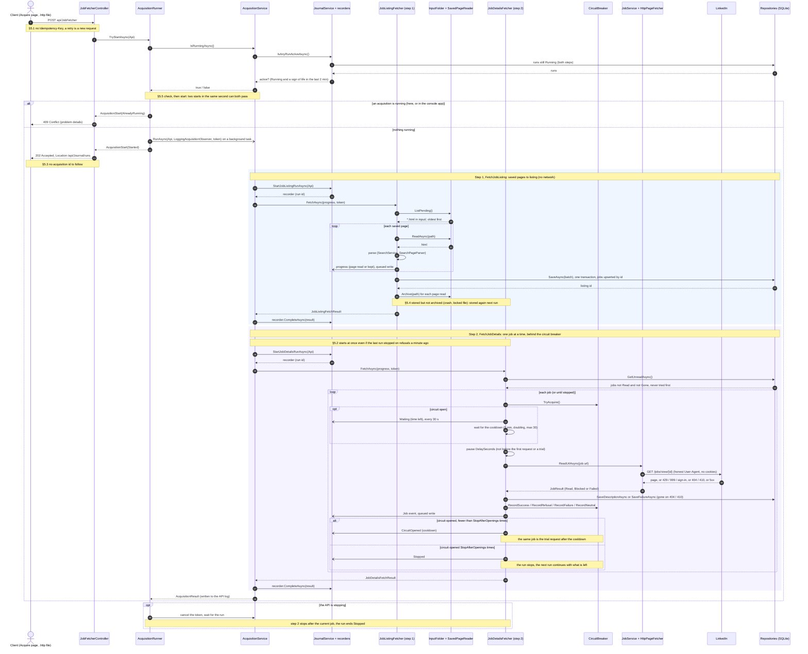
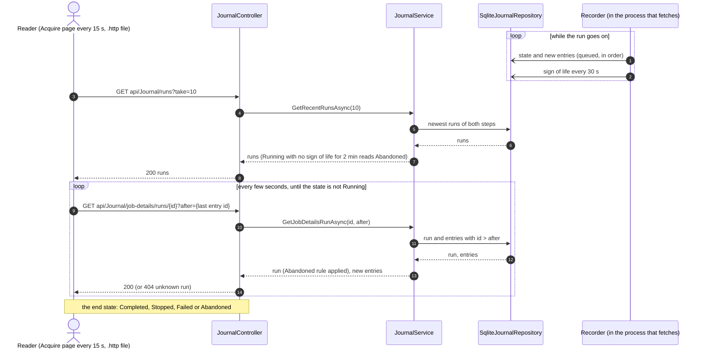

# Sequence diagrams (UML)

Two UML sequence diagrams, written in [Mermaid](https://mermaid.js.org/syntax/sequenceDiagram.html), so GitHub, Azure DevOps and VS Code (with a Mermaid preview) draw them from this file, and they can be edited as text. Rendered copies: [`acquisition-sequence.svg`](acquisition-sequence.svg) and [`journal-sequence.svg`](journal-sequence.svg); after editing this file, render them again (for example with the Mermaid CLI or mermaid.live). For the components and layers, see [`architecture.svg`](architecture.svg).

How to read them: time runs downwards; a solid arrow is a call, a dashed arrow its answer, an open arrow (`-)`) a message that does not wait (background work, queued journal writes). The notes marked **§5.n** are the places that are not idempotent yet, see [`backlog.md`](backlog.md), section 5.

## 1. An acquisition started from the API

The console app follows the same path from `AcquisitionService` on: `PipelineConsole` calls `IsRunningAsync()` (exit code 4 if an acquisition is running), then `RunAsync(Console, PipelineConsole, token)` directly, without a runner, and prints instead of logging. Ctrl+C cancels the token during step 2.

## 2. Following a run through the journal

