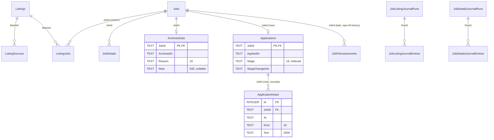

# Spec: tracking the jobs I applied to

Status: agreed 19 Oct 2026, not built yet. Built **before** `spec-fit-history.md`. Like the other `spec-*.md` files, this spec stands on its own; `spec.md` and `database.md` are not updated until the owner asks for the docs to be brought up to date.

## Goal

The purpose of the app is applying to jobs. After applying on the job's own page (opened from the details pane in another tab), the owner tells the app "I applied". The job leaves the Overview and moves to a new **Applications** page. That page is a short, living list: the applications still worth attention, with their stage, a timeline of notes and a flag when a follow-up is due. Applications that are over are closed by hand and leave the list.

## Decisions

| # | Decision |
| --- | --- |
| 1 | **I applied** in the Overview's details pane (button, or key **A**). The job leaves the Overview at once and the next job opens, as when archiving from the pane. |
| 2 | Stages: **Applied, Interview, Offer** (open) and **Rejected, Withdrawn, No answer** (closed). The stage is changed by hand only; the app never changes it by itself. Interview and Offer follow their own course and get no flags. |
| 3 | Follow-up flags, only while the stage is **Applied**: from day **7** after applying the row is flagged **Follow up** (contact them to learn the status); from day **21** (3 weeks) it is flagged **No answer**, with a one-click **Close as No answer**. The flag never closes the application: closing stays the owner's action. The flags are computed from the date of applying; nothing is stored for them. |
| 4 | Closed applications (Rejected, Withdrawn, No answer) **leave the Applications list**, keeping their stage and timeline. A "Show closed (n)" switch brings them back, greyed, like "Show archived"; any of them can be **reopened** by choosing an open stage. |
| 5 | Notes are a **timeline, newest on top, add-only**. Applying and every stage change add a line to it by themselves. |
| 6 | **Undo** is for a mistake ("I never applied"): from the confirmation line after applying, or from the Applications pane, the job goes back to the Overview. Undo deletes the application row, and its timeline with it (cascade). If the timeline holds **notes the owner wrote**, Undo warns first ("This application has 2 notes. Undo deletes them too.") and deletes only after confirmation; without such notes it deletes at once. The automatic lines (Applied, stage changes) never cause a warning. |
| 7 | Applied and archived **exclude each other**: an archived job cannot be applied to, an applied job is never listed in the Overview (so it cannot be archived). |
| 8 | The feature is kept apart: its own `Applications` folders in every layer. Outside them, only three things change: the Overview's job list leaves applied jobs out, step 2's work list leaves them out, and the menu gets an entry. |
| 9 | Fit assessments are stored and shown by a separate feature, `spec-fit-history.md`, built after this one. It adds a Fit column and sorting by fit to this page. |

## Stages

| Value (stored) | Shown as | Open? | Flags |
| --- | --- | --- | --- |
| `Applied` | Applied | open | day 7 Follow up, day 21 No answer |
| `Interview` | Interview | open | none |
| `Offer` | Offer | open | none |
| `Rejected` | Rejected | closed | none |
| `Withdrawn` | Withdrawn (I stepped back) | closed | none |
| `NoAnswer` | No answer | closed | none |

The list lives in code (`ApplicationStage`); a new stage is one line, no migration. Any stage can be chosen from any other, so a closed application can be reopened from "Show closed" if a late answer arrives.

## Follow-up flags

Counted in whole days from `AppliedAt` to today (local time), only while the stage is `Applied`:

| Days since applying | Flag | Shown |
| --- | --- | --- |
| 0–6 | none | the Follow-up column shows the date the flag appears, e.g. "from 26 Oct" |
| 7–20 | **Follow up** (amber row marker and tag) | "Follow up · 9 days": time to contact them and ask for the status |
| 21 and more | **No answer** (red row marker and tag) | "No answer · 23 days", and in the pane a button **Close as No answer** |

The flags never close anything. Moving to Interview or Offer, or closing, removes them. Contacting them does not reset the flag; the owner adds a note ("emailed the recruiter") and the flag stays until the stage changes. The 7 and 21 days are constants in one helper.

The menu entry shows two numbers: the open applications, and (red) how many are flagged.

## Data

Two new tables (migration `AddApplications`, which only creates them):

**`Applications`**, one row per job applied to:

| Column | Type | Meaning |
| --- | --- | --- |
| `JobId` | TEXT, PK, FK → `Jobs.JobId` (cascade) | the job |
| `AppliedAt` | TEXT (date and time) | when "I applied" was clicked |
| `Stage` | TEXT(16), indexed | one of the stages, by name |
| `StageChangedAt` | TEXT (date and time) | when the stage last changed (equals `AppliedAt` at first) |

**`ApplicationNotes`**, the timeline:

| Column | Type | Meaning |
| --- | --- | --- |
| `Id` | INTEGER, PK | |
| `JobId` | TEXT, FK → `Applications.JobId` (cascade), index (`JobId`, `At`) | the application |
| `At` | TEXT (date and time) | when the line was added |
| `Kind` | TEXT(16) | `Applied`, `Stage` or `Note` (only `Note` is written by the owner) |
| `Text` | TEXT(2000) | the owner's note, or "Interview → Offer" for a stage line |

A job is applied to when it has a row in `Applications`. Undo deletes that row, and its timeline with it (cascade from `Applications` to `ApplicationNotes`), after the warning described in decision 6 when the owner wrote notes. Closing never deletes anything. Nothing else in the database changes.

How the rest of the app treats an applied job:

| Where | Behaviour |
| --- | --- |
| Step 1 (FetchJobListing) | Unchanged. A page listing an applied job adds it to the listing as usual; it stays applied. |
| Step 2 (FetchJobDetails) | Its work list leaves applied jobs out (most are read already; this only guarantees no request). |
| Overview, API job list | Left out, also with "Show archived" ticked, and left out of every count and chip. |
| API one job (`GET api/JobCatalog/{id}`) | Unchanged. |
| Archive | Applied jobs are never offered for archiving (they are not listed). The archive code is not changed. |
| Journal, Acquire page | Unchanged. |

## API

`ApplicationsController`, all answers as problem details on error, `503` while there is no database.

| Call | Does | Errors |
| --- | --- | --- |
| `POST api/Applications` `{ "jobId": "…" }` | applies: stage Applied, a first `Applied` line in the timeline. Returns the application. | 404 unknown job; 409 already applied; 409 archived |
| `DELETE api/Applications/{jobId}?withNotes=false` | undo: deletes the application and its timeline (cascade). When the timeline has owner notes and `withNotes` is not `true`, nothing is deleted and the answer is 409 with the number of notes, so the page can warn and retry with `withNotes=true`. | 404 not applied; 409 has notes |
| `GET api/Applications?closed=false&stage=` | the list: open applications (or closed ones with `closed=true`), each with title, company, location, stage, dates, days since applying, flag, and the last note. Also the counts per stage and the number of flagged applications. | |
| `GET api/Applications/{jobId}` | one application with its full timeline (newest first) | 404 |
| `PUT api/Applications/{jobId}/stage` `{ "stage": "Interview" }` | changes the stage and adds a `Stage` line; the same stage again changes nothing | 400 unknown stage; 404 |
| `POST api/Applications/{jobId}/notes` `{ "text": "…" }` | adds a note, dated now | 400 empty, or over 2000 characters; 404 |
| `GET api/Applications/summary` | `{ open, flagged }` for the menu numbers | |

The flags are computed in Services (`internal static` helper `FollowUpRules`, pure: stage, applied date and today in, flag out), so the 7 and 21 days live in one place.

## Overview (changes)

- In the details pane, next to **Open the job page ↗**: **✓ I applied** (key **A**, when the cursor is not in a text field).
- After applying: the next job opens (the same rule as archiving from the pane) and a green line says "Applied: *title*. Follow up from *date*. **Undo** · **Open in Applications**". Undo posts to the Overview, deletes the application and opens that job again (right after applying there are no owner notes, so no warning).
- An archived job (seen with "Show archived") has no I applied button.

## Applications page

New menu entry **Applications**, between Overview and Acquire, with the two numbers.

- **Header**: "Applications", "11 open · 2 need a follow-up", and on the right **Show closed (n)** (`?closed=1`).
- **Chips**: All open · Needs follow-up · Applied · Interview · Offer, with counts (`?stage=…`, `?flagged=1`).
- **Table**: Title, Company, Location, Stage (coloured tag), Applied (date and "12 days"), Follow-up (flag, or "from 26 Oct"), Last note (first 60 characters). Order: flagged No answer first, then Follow up, then the rest by date of applying, newest first. 25 per page as in the Overview. Clicking a row opens the pane (`?job=…`); ↓ / ↑ move between rows.
- **Pane**:
  1. Title, company · location, "applied 8 Oct (11 days ago)", **Open the job page ↗**.
  2. **Stage**: the six stages as buttons, the current one dark; closed stages drawn dashed. With the No answer flag, an extra **Close as No answer**.
  3. **Flag** line when there is one ("Follow up · 9 days: contact them for the status").
  4. **Notes**: a box with **Add note** (Ctrl+Enter), then the timeline, newest on top; stage and applied lines in small capitals.
  5. "Not applied after all? **Move back to the Overview**" (undo of a mistake: deletes the application; when it has notes the owner wrote, a warning "This application has 2 notes. Undo deletes them too." with **Delete with notes** / **Cancel**; otherwise it deletes at once).
  6. The job's facts and description, as in the Overview pane.
- Closing an application (Rejected, Withdrawn, No answer) removes it from the list at once and opens the next one, with a line "Closed as No answer. **Undo**" (undo puts the previous stage back).

Everything works without JavaScript (forms post and redirect, as in the Overview); the keys and Ctrl+Enter need the script.

## Out of scope

Automatic closing, reminders outside the app (mail, notifications), reminders for Interview and Offer, editing or deleting single notes, attachments (CV versions, letters), a text filter on the Applications page, statistics. Fit scores: `spec-fit-history.md`.

## Acceptance

1. The migration adds `Applications` and `ApplicationNotes` and changes nothing else: on a copy of the owner's database every existing table keeps its rows and values.
2. I applied (button and key A) removes the job from the Overview and its counts, opens the next job and shows the line; Undo brings it back with nothing left in the two tables. With an owner note, Undo warns first: Cancel keeps everything, confirming deletes the application and all its notes (also checked through the API: 409 without `withNotes=true`).
3. The job appears on the Applications page with stage Applied, the Applied line in its timeline and "from *date + 7*" as follow-up.
4. With dates moved back in a test database: 6 days shows nothing, 7 shows Follow up, 21 shows No answer and the Close button; Interview removes the flag; the menu numbers agree.
5. Stage changes add timeline lines; closing removes the row from the list and Show closed shows it; reopening works.
6. Notes are added newest on top; empty or over 2000 characters are refused with a message.
7. Applying an archived or applied job is refused (409); step 2 never requests an applied job.
8. Overview, filters, location chips, archiving, Check fit and the Acquire page behave as before (the existing UI tests pass).

## Later: fit

`spec-fit-history.md` stores every Check fit in its own table and adds to this page a **Fit** column (the latest score) and sorting by fit. Nothing in this spec depends on it.
