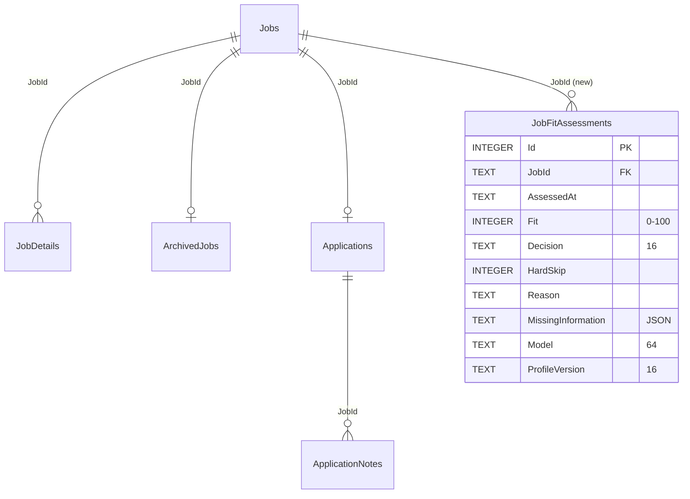

# Spec: keeping every fit assessment, showing and sorting by fit

Status: agreed 19 Oct 2026, not built yet. Built **after** `spec-applications.md`. Like the other `spec-*.md` files, this spec stands on its own; `spec.md` and `database.md` are not updated until the owner asks for the docs to be brought up to date.

## Goal

Every time Check fit scores a job, the result is kept: the fit (0–100), the decision and the AI's text, for later reference. The latest fit of each job is shown as a number in the Overview and on the Applications page, and both lists can be sorted by it, so the most attractive postings stand out.

This replaces the rule "do not store scores unless I ask": the owner asked for it on 19 Oct 2026.

## Decisions

| # | Decision |
| --- | --- |
| 1 | Every successful assessment is stored, as its own row: **history**, never overwritten. A failed, cancelled or unreadable answer stores nothing. |
| 2 | A new table **`JobFitAssessments`**, not columns on `Jobs`: `Jobs` belongs to the acquisition, and fit is the owner's judgement, like `ArchivedJobs` and `Applications`. |
| 3 | The lists show the **latest** assessment of each job. Older ones are shown in the details pane. |
| 4 | **Sort by fit** in the Overview and on the Applications page: best fit first, jobs never assessed last, ties newest first. |
| 5 | Each row records the model and a short **profile version** (a hash of the three Fit files), so scores made with an older profile or rubric can be recognised. The files' content is never stored. |
| 6 | The assessment is stored by the API, inside the fit service, right after the model's answer is read. The web never writes it. |
| 7 | Kept apart: its own `Fit` folders in Data (and a store interface in `Services/Abstractions/Fit`). Changes outside them are listed under "Changes to existing code". |

## Data

New table `JobFitAssessments` (migration `AddJobFitAssessments`, which only creates it):

| Column | Type | Meaning |
| --- | --- | --- |
| `Id` | INTEGER, PK | |
| `JobId` | TEXT, FK → `Jobs.JobId` (cascade), index (`JobId`, `AssessedAt`) | the job |
| `AssessedAt` | TEXT (date and time) | when the answer came back |
| `Fit` | INTEGER, 0–100 | the score |
| `Decision` | TEXT(16) | `Apply`, `Maybe` or `Skip` |
| `HardSkip` | INTEGER (0/1) | a hard rule matched |
| `Reason` | TEXT | the model's sentence, as returned |
| `MissingInformation` | TEXT | the model's list, as a JSON array (`[]` when empty) |
| `Model` | TEXT(64) | the model that answered, e.g. `qwen2.5:3b` |
| `ProfileVersion` | TEXT(16) | first 12 hex characters of a SHA-256 over the three Fit files as loaded for that assessment |

About 1 KB per assessment. Deleting a job deletes its assessments (cascade); archiving, applying and undoing an application do not touch them.

**Privacy.** The `Reason` and `MissingInformation` texts are written from the owner's profile and can echo it (a missing skill, a salary limit). They live only in `jobs.db`, under the data folder outside the repository. The Fit JSON files themselves are never copied into the database; only their hash is.

## API

| Call | Change |
| --- | --- |
| `POST api/JobFit` | Same request and answer as today. After a good answer the assessment is stored before the response is sent; if storing fails, the answer is still returned and the failure is logged (scoring is never lost because of the store). The answer gains `assessedAt`. |
| `GET api/JobFit/{jobId}` (new) | The job's assessments, newest first, and `currentProfileVersion` (to mark older ones). 404 for an unknown job; an empty list when never assessed. |
| `GET api/JobCatalog?…&sort=newest\|fit` | Each job gains `fit`: the latest `{ fit, decision, hardSkip, assessedAt }`, or null. `sort=fit` orders best fit first, never-assessed last, ties by newest; `newest` (default) is today's order. Works with every filter. |
| `GET api/Applications?…&sort=flag\|fit` | Each application gains `fit` as above. `flag` (default) is the order from `spec-applications.md`; `fit` sorts best fit first. |

## Overview

- **Fit column** after Title: the latest score as a small coloured number (green Apply, amber Maybe, grey Skip; a struck-through number for a hard skip), "—" when never assessed. The tooltip gives the decision and the date.
- **Sort**: "Sort: **Newest** · Best fit" next to the filter (`?sort=fit`), kept in the address and by every link, form and archive action like the other filters. The Fit column header is a shortcut for the same switch.
- **Pane**: when the job has an assessment, the fit card shows at once (no new run): score, decision, reason, missing information, "checked 19 Oct 14:02 · qwen2.5:3b", and **Check again**. Below it, "3 earlier checks" opens a list (date, score, decision, reason); one made with another profile version is marked "older profile". **F** and the archive note prefill work as today, using the latest assessment.

## Applications page

- The same **Fit** column and colours.
- Sort: "**Follow-up first** · Best fit" (`?sort=fit`).
- The pane shows the latest assessment and the earlier ones, as in the Overview, with **Check again**.

## Changes to existing code

Kept small and listed here so they are reviewed on purpose:

| Where | Change |
| --- | --- |
| `Services/Fit/JobFitService` | After reading the model's answer: compute the profile version from the `FitPack` it loaded, and call the new `IJobFitAssessmentStore.AddAsync(...)` with the result, the model name from `ChatResponse.Model` and the time. One new dependency; the prompt, parsing and rules do not change. |
| `Models/Fit/JobFitResult` | gains `AssessedAt`. |
| `Api/Controllers/JobFitController` | the summary no longer says "Nothing is saved"; new `GET {jobId}`. |
| `SqliteJobCatalog` (filter candidates) and the Applications list | read the latest assessment per job, in the same query. |
| `JobRetriever.GetPageAsync` | the `sort` parameter. |
| Web Overview / Applications | the Fit column, the sort switch, the stored fit card. |

## Out of scope

Filtering by fit ("70 or more"), re-scoring many jobs in one go, scoring automatically after the acquisition, deleting assessments, comparing models, charts.

## Acceptance

1. The migration adds `JobFitAssessments` and changes nothing else (table hashes of a copy of the owner's database).
2. Each successful Check fit adds one row with all columns filled; a cancelled run, Ollama down (503) or an unreadable answer add none (checked with the fake Ollama server).
3. The Overview and Applications show the latest score per job and "—" for unassessed jobs; after Check again the number changes and the pane lists the earlier check.
4. Sort by fit orders best first, unassessed last, ties newest first; it survives paging, filters, location chips, Show archived, archiving and opening a job.
5. Changing one Fit file marks earlier assessments as "older profile".
6. If storing fails, the fit card still shows the answer.
7. Without assessments everything behaves as before (existing UI tests pass).
