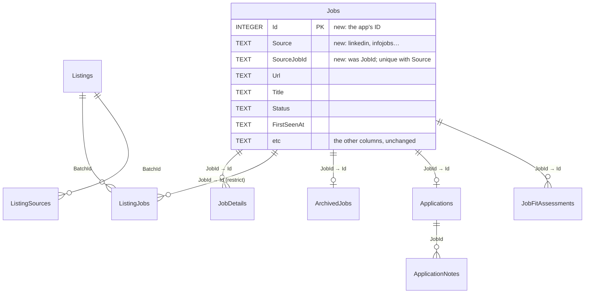

# Spec: the app's own job ID, ready for more sources than LinkedIn

Status: agreed 19 Oct 2026 (option B); updated 20 Oct 2026 for the Notion import; built 20 Oct 2026. Like the other `spec-*.md` files, this spec stands on its own; `spec.md`, `database.md` and the diagrams are not updated until the owner asks for the docs to be brought up to date.

## Goal

Today a job is identified by LinkedIn's own number: `Jobs.JobId = "4476446382"`, and every table that refers to a job uses it. Jobs from another site (InfoJobs, Teletrabajo, …) could use the same number for a different offer, their numbers would not sort with LinkedIn's, and some sites may have no stable number at all.

After this change the app gives each job **its own ID**, and records **where the job comes from** and **that site's ID** as data. Nothing else changes for the owner: the same jobs, archives, applications, notes and fit scores, in the same order.

## Decisions

| # | Decision |
| --- | --- |
| 1 | `Jobs.Id`: an integer the app gives out (1, 2, 3…), the primary key. It never changes and has no meaning outside the app. |
| 2 | `Jobs.Source` (e.g. `linkedin`) and `Jobs.SourceJobId` (that site's ID, e.g. `4476446382`), **unique together**. Two sites may use the same number; the same site cannot store a job twice. |
| 3 | Every table that refers to a job points at `Jobs.Id`: `JobDetails`, `ListingJobs`, `ArchivedJobs`, `Applications` (and through it `ApplicationNotes`), `JobFitAssessments`. |
| 4 | Existing jobs get IDs so that today's order is kept: first the LinkedIn jobs in the order of their numbers (lowest = 1), then the Notion jobs in the order they were imported (`FirstSeenAt`, then their old ID). New jobs get the next ID when they are first found. "Newest first" becomes "**most recently found first**"; for the Overview, which only lists LinkedIn jobs today, the order is unchanged. |
| 5 | Addresses use the app's ID: `/?job=57`, `/applications?job=57`, `api/JobCatalog/57`. **Old addresses with a LinkedIn number stop working** ("There is no job …"); no redirect. |
| 6 | The pane shows both: `#57 · LinkedIn 4476446382`. "Open the job page ↗" is unchanged (the stored URL). |
| 7 | A site without a stable ID: `SourceJobId` is `u:` followed by the first 16 hex characters of a SHA-256 of the job's canonical URL (lower-case host, no query string or fragment). Each source's reader decides which rule it uses. |
| 7b | **Existing IDs** (see "Existing jobs" below): a plain number is a LinkedIn posting, `Source = linkedin`; anything else (`Notion-A027`, `InfoJobs-A071`, `Corporate-A033`, `Tecnoempleo-A164`, `Recruiter-A005`) came from the Notion import, `Source = notion`. In both cases `SourceJobId` is **the old ID, unchanged** (so `Notion-A027` stays `Notion-A027`, and the site name it carries is kept). |
| 8 | The journal (`JobListingJournal*`, `JobDetailsJournal*`) is history and is **not changed**: its entries keep the text ID that was requested at the time (the LinkedIn number). |
| 9 | Only LinkedIn exists after this change. Adding InfoJobs or Teletrabajo is a later spec; this one only makes room for them. The same offer published on two sites is two jobs (linking them is out of scope). |
| 10 | The migration keeps every row. A copy of `jobs.db` is made in the data folder before the first start with the new version (by Claude when delivering, with the owner's permission), and the migration is checked on copies of the owner's database first. |

## Existing jobs (20 Oct 2026)

The owner's database holds 285 jobs:

| Old `JobId` | Count | Status | `Source` | `SourceJobId` |
| --- | --- | --- | --- | --- |
| a number, e.g. `4476446382` | 111 found by the acquisition, 55 imported from Notion | Read, Pending, Blocked; External | `linkedin` | the number |
| `Notion-A027` (no LinkedIn number in Notion; one row, `Notion-A001`, had no source) | 66 | External | `notion` | `Notion-A027` |
| `Corporate-A033`, `Tecnoempleo-A164`, `Recruiter-A005`, `InfoJobs-A071` | 33, 10, 9, 1 | External | `notion` | the old ID |

Why `notion` and not `infojobs` for `InfoJobs-A071`: `A071` is a Notion row, not an InfoJobs offer ID. When InfoJobs is read directly one day, its real offer IDs can never collide with these.

The jobs' other columns (`Status` External, the Notion page in `Url`, `FirstSeenAt`) are copied unchanged. The one-time import tool (`tools/JobFetchProbe.NotionImport`) is adapted so it still builds with the new key; it is not run again.

## Data

| Table | Before | After |
| --- | --- | --- |
| `Jobs` | `JobId` TEXT PK | `Id` INTEGER PK (autoincrement); `Source` TEXT(32) not null; `SourceJobId` TEXT(128) not null; unique index (`Source`, `SourceJobId`); every other column unchanged |
| `JobDetails` | `JobId` TEXT → Jobs | `JobId` INTEGER → `Jobs.Id` (cascade); index (`JobId`, `Position`) |
| `ListingJobs` | PK (`BatchId`, `JobId` TEXT) | PK (`BatchId`, `JobId` INTEGER) → `Jobs.Id` (restrict) |
| `ArchivedJobs` | PK `JobId` TEXT | PK `JobId` INTEGER → `Jobs.Id` (cascade) |
| `Applications` | PK `JobId` TEXT | PK `JobId` INTEGER → `Jobs.Id` (cascade) |
| `ApplicationNotes` | `JobId` TEXT → Applications | `JobId` INTEGER → `Applications.JobId` (cascade) |
| `JobFitAssessments` | `JobId` TEXT → Jobs | `JobId` INTEGER → `Jobs.Id` (cascade) |
| `Listings`, `ListingSources`, journal tables | | unchanged |

The column name `JobId` stays in the child tables; it now holds the app's ID. In code, the LinkedIn number is only ever called `SourceJobId`.

### Migration `UseOwnJobIds`

Hand-written SQL, because SQLite cannot change a primary key or a foreign key in place: each table is rebuilt (new table, copy, drop, rename), the documented SQLite way.

1. `Jobs`: create the new table and copy every job with `SourceJobId = JobId` and `Source` by the rule in decision 7b. `Id` is given first to the LinkedIn jobs in the order `length(JobId), JobId`, then to the others in the order `FirstSeenAt, JobId` (decision 4).
2. Each child table: create the new table, copy every row with its `JobId` replaced by the new `Id` of the same job (a join on the old ID), drop the old table, rename.
3. Recreate the indexes; run `PRAGMA foreign_key_check`, which must return nothing; the migration fails (and changes nothing) otherwise.
4. Down: not supported (the copy from decision 10 is the way back).

## Code

| Layer | Change |
| --- | --- |
| Models | `StoredJob`, `JobSummary`, `ApplicationSummary`: `JobId` becomes `long`, plus `Source` and `SourceJobId`. Requests that name jobs (`ArchiveRequest.JobIds`, `ApplyRequest`, `JobFitRequest`) take the app's ID. The step models (`JobListing`, `JobPosting`) carry `Source` and `SourceJobId` instead of `JobId`. A new `JobSources` constant list (`linkedin` for now). |
| Services | `JobIdResolver` becomes the LinkedIn reader of `SourceJobId` (same parsing). Step 1 and step 2 work with (`Source`, `SourceJobId`); their rules do not change. Archive, Applications and Fit use the app's ID; their rules do not change.  The `u:` URL-hash rule (decision 7) is added with the first source that needs it. |
| Data | Entities, configurations and repositories as in the table above. Step 1 finds an existing job by (`Source`, `SourceJobId`) and otherwise adds it (the new `Id` comes from the database). Step 2 finds the job it read by (`Source`, `SourceJobId`), as step 1 does. The lists sort by `Id` descending instead of the LinkedIn number. |
| API | Routes and parameters with a job take the app's ID (`api/JobCatalog/{id}`, `api/JobFit/{id}`, `api/Applications/{id}`…). A non-numeric or unknown ID is a 404, as an unknown one is today. |
| Web | Links and forms use the app's ID. The pane's top line shows `#57 · LinkedIn 4476446382`. `/jobs/{id}` keeps forwarding to `/?job={id}` (it then finds only app IDs). |

## Out of scope

Reading InfoJobs, Teletrabajo or any other site; linking the same offer across sites; redirecting old addresses; changing the journal; a Down migration.

## Acceptance

1. On a copy of the owner's database: after the migration every table has the same number of rows as before (285 jobs, 185 applications, 856 notes, 233 fit scores including the 173 `score-card` ones, 370 listing rows including the `notion-migration` batch, 100 archived), and each row is attached to the job with the **same old ID** as before (checked by joining back to `SourceJobId`). Every job keeps its `Status` (External included). `PRAGMA foreign_key_check` is empty.
2. The Source split is 166 `linkedin` and 119 `notion`, as in the table above.
3. The Overview, the Applications page and their filters, chips and sorts list the same jobs in the same order as before the migration.
4. The acquisition on the local test site, both on a new database and on a migrated copy: step 1 adds new jobs with the next IDs and does not duplicate known ones; step 2 reads them; archived and applied jobs are still not requested.
5. Storing the same (`Source`, `SourceJobId`) twice is refused by the database; the same `SourceJobId` under another `Source` is accepted.
6. `/?job=57` opens the job; `/?job=4476446382` says there is no such job.
7. Archive, I applied / Undo, notes, stage changes and Check fit work as before (the existing UI tests, adapted to the new IDs, pass).
